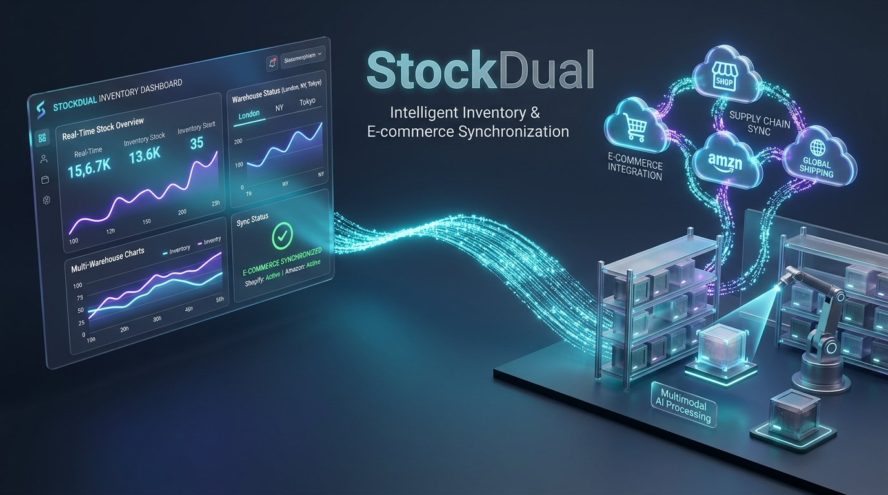
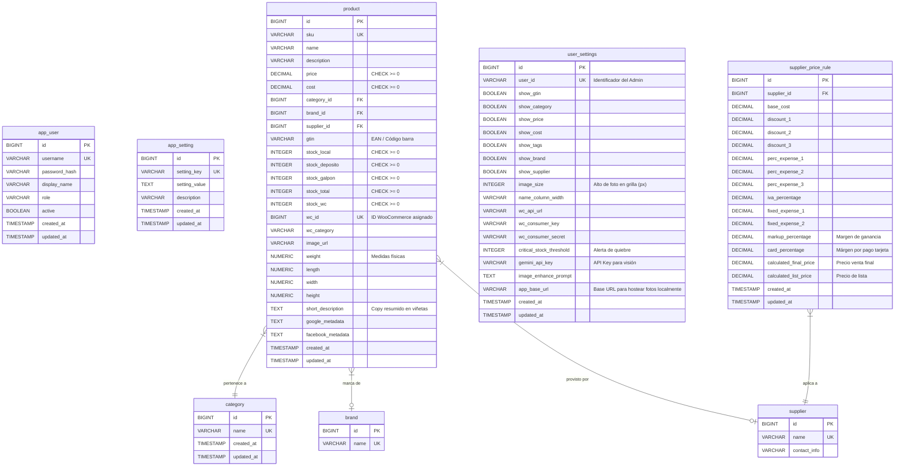

# 🚀 StockDual — Sistema Empresarial de Control de Stock e Integración con WooCommerce & IA

<p align="center">
  
</p>

[](https://openjdk.org/)
[](https://spring.io/projects/spring-boot)
[](https://vaadin.com/)
[](https://www.postgresql.org/)
[](https://deepmind.google/technologies/gemini/)

**StockDual** es una plataforma backend híbrida de nivel empresarial diseñada para optimizar la gestión de inventario y facturación multi-ubicación (*Local, Depósito y Galpón*). El sistema cuenta con una interfaz web reactiva de alto rendimiento, un motor de sincronización bidireccional avanzado con **WooCommerce** y un creador inteligente de productos asistido por la API multimodal de **Google Gemini**.

---

## 🌟 Descripción Premium del Sistema

Diseñado bajo rigurosos patrones de desarrollo corporativo, **StockDual** actúa como el núcleo unificado para comercios con presencia física (POS) y tiendas online (WooCommerce). Resuelve de forma nativa la discrepancia de inventarios, optimiza las tareas de auditoría rápida y acelera drásticamente la catalogación de nuevos artículos mediante visión por computadora (IA).

### Pilares Fundamentales
*   **Gestión Multi-Ubicación Inteligente**: Control granular y segmentado en tiempo real de existencias en el local principal, depósitos secundarios y almacenes a gran escala, calculando y consolidando métricas totales automáticamente.
*   **Edición Dinámica de Alta Densidad**: Grilla interactiva estilo "Excel" para auditorías veloces, con capacidad de edición directa (*inline editing*) y persistencia asíncrona segura.
*   **Fusión de Catálogos e Integración Woo**: Motor que mapea y sincroniza marcas, proveedores, códigos de barra (GTIN/EAN), precios y stocks, gestionando de forma proactiva las discrepancias.
*   **Creador de Productos Inteligente (Multimodal IA)**: Flujo móvil y de escritorio que recibe imágenes capturadas directamente con la cámara del dispositivo, las limpia algorítmicamente y consulta a **Gemini 2.0** para extraer y estructurar automáticamente títulos comerciales, descripciones optimizadas para SEO, viñetas de especificaciones y etiquetas de venta.

---

## ⚙️ Stack Tecnológico Detallado

*   **Lenguaje & JDK**: **Java 25 (Amazon Corretto)**. Aprovechamiento de características modernas del lenguaje (virtual threads para tareas de fondo, pattern matching y records optimizados).
*   **Framework Core**: **Spring Boot 3.4.2**
    *   *Spring Data JPA*: Para la capa de acceso a datos, implementando `@EntityGraph` para evitar el problema de consultas N+1 y optimizar las transacciones.
    *   *Spring Security*: Autenticación robusta basada en Spring Security para control de accesos de administradores y operarios.
    *   *Spring Web / RestTemplate*: Consumo asíncrono y estructurado de la API de WooCommerce y de la API REST de Google Gemini.
*   **Frontend**: **Vaadin Flow 24.6.4**
    *   Arquitectura reactiva 100% Java con renderizado en el servidor (SSR).
    *   Binding estructurado y validación inmediata mediante la API `Binder`.
    *   Integración nativa con cámara del dispositivo mediante HTML5 y empaquetado optimizado en producción mediante Vite.
*   **Base de Datos**: **PostgreSQL 16 (Alpine-based)**
    *   *Integridad de datos*: Constraints a nivel de base de datos (`CHECK` para evitar stocks o precios negativos).
    *   *Evolución controlada*: Control de versiones y migraciones automáticas mediante **Flyway**.
    *   *Rendimiento*: Indexación estratégica en campos de alta frecuencia de búsqueda (`sku`, `gtin`, `wc_id`, claves foráneas).
*   **Procesamiento Gráfico & Compresión**:
    *   Algoritmos de redimensión proporcional (canvas 650x650px).
    *   *Background Un-saturation*: Filtro algorítmico personalizado en Java que analiza canales RGB para eliminar el ruido de fondo (tonos grises/blancos sucios) y forzar un fondo blanco puro (`#FFFFFF`) adecuado para e-commerce.
    *   *WebP compression*: Integración del plugin `webp-imageio-sejda` para salida de imagen ultra-liviana.

---

## 📊 Arquitectura & Flujos de Datos

### 1. Diagrama de Flujo de Integración (StockDual ↔️ WooCommerce ↔️ Gemini API)

Este diagrama ilustra el flujo de creación de un producto desde la captura de la foto con un dispositivo móvil, el enriquecimiento con IA y el posterior despliegue bidireccional en WooCommerce.

```mermaid
graph TD
    %% Estilos de los nodos
    classDef principal fill:#e3f2fd,stroke:#0d47a1,stroke-width:2px,color:#0d47a1;
    classDef secundario fill:#f1f8e9,stroke:#33691e,stroke-width:2px,color:#33691e;
    classDef externo fill:#fff3e0,stroke:#e65100,stroke-width:2px,color:#e65100;
    
    subgraph Local [Entorno StockDual (Backend & UI)]
        PCV["ProductCreatorView (Frontend Vaadin)"]:::principal
        IPS["ImageProcessingService (Procesador WebP)"]:::principal
        DB[("PostgreSQL 16 (Flyway V13 Schema)")]:::principal
        WCS["WooCommerceSyncService (Sincronizador)"]:::principal
    end

    subgraph Gemini [Servicio Cognitivo Externo]
        GAPI["Gemini API (gemini-2.0-flash)"]:::externo
    end

    subgraph Tienda [WooCommerce Online Store]
        WCAPI["WooCommerce REST API"]:::externo
        POS["POS / Venta Física"]:::secundario
    end

    %% Relaciones y flujo
    PCV -->|1. Captura nativa / Carga foto| IPS
    IPS -->|2. Escala 650x650 & Desatura fondo a blanco puro| PCV
    PCV -->|3. POST Image Bytes & Prompt| GAPI
    GAPI -->|4. Retorna JSON estructurado (Copywriting)| PCV
    PCV -->|5. Confirma datos y guarda registro local| DB
    
    WCS -->|6. Lee discrepancias y nuevos productos| DB
    WCS -->|7. POST Extended Draft (SEO, Medidas, Foto WebP)| WCAPI
    WCAPI -->|8. Actualiza stock_wc local tras ventas web| WCS
    POS -->|9. Descuenta stock local físico| DB
    WCS -->|10. Pushes batch de stock consolidado| WCAPI
```

---

### 2. Diagrama Entidad-Relación de la Base de Datos (Versión V13)

Esquema relacional implementado en PostgreSQL. Contiene las tablas de dominio, la configuración de parámetros y la tabla de cálculo del Formador de Precios.



---

## 🖥️ Showcase & Capturas de la Interfaz

> [!NOTE]
> Las siguientes secciones representan las vistas principales del sistema. Los placeholders indican la ubicación de las capturas de pantalla de alta resolución.

### 1. Panel de Control de Stock (Excel-Like Grid)
Grilla compacta optimizada para operaciones rápidas. Permite auditar SKU, código GTIN, marca, stock total y distribuciones físicas locales. Los registros con inconsistencias de inventario con respecto a WooCommerce se destacan visualmente de forma inmediata.

<figure>
  
  <figcaption align="center"><b>Figura 1:</b> Vista del Panel de Stock. Grilla con edición interactiva inline, filtros cruzados por categorías y resaltado de discrepancias.</figcaption>
</figure>

---

### 2. Creador Inteligente de Productos (IA Gemini)
Módulo adaptativo optimizado para dispositivos móviles y de escritorio. Utiliza la cámara del celular para capturar la foto del producto, procesarla a blanco puro, y enviar los bytes a la API de Gemini para autocompletar el formulario de WooCommerce.

<figure>
  
  <figcaption align="center"><b>Figura 2:</b> Interfaz del Creador de Productos. Carga de foto nativa, barra de progreso del análisis de Gemini e inputs autocompletados.</figcaption>
</figure>

---

### 3. Formador de Precios (Planilla de Costos)
Módulo de cálculo reactivo donde los costos se procesan en cascada dinámica (descuentos sucesivos, impuestos e IVA, logística y márgenes de utilidad) para fijar precios comerciales de venta final y lista.

<figure>
  
  <figcaption align="center"><b>Figura 3:</b> Panel de Formación de Precios. Tabla matemática para determinar precios de venta sobre costos base del proveedor.</figcaption>
</figure>

---

### 4. Ajustes del Sistema y Credenciales
Panel centralizado de configuración donde se administran las API keys de WooCommerce, Gemini AI, umbrales de stock crítico e interfaces de visualización personalizadas.

<figure>
  
  <figcaption align="center"><b>Figura 4:</b> Formulario de Ajustes. Configuración del umbral de alerta de inventarios y credenciales de APIs de terceros.</figcaption>
</figure>

---

## 🛠️ Configuración e Instalación del Entorno

### Requisitos Previos
*   **Java**: JDK 21 o Java 25 (Recomendado Amazon Corretto 25).
*   **Docker**: Docker Desktop con soporte para Docker Compose.
*   **Maven**: Opcional (se incluye el envoltorio `./mvnw` en el proyecto).

### 1. Iniciar la Base de Datos (Docker)
El proyecto incluye un archivo `docker-compose.yml` preconfigurado para levantar PostgreSQL en el puerto **5433**:

```bash
docker-compose up -d
```

### 2. Configurar Variables de Entorno
La aplicación lee la configuración desde `src/main/resources/application.yml`. Puede sobrescribir las propiedades clave utilizando las siguientes variables de entorno:

| Variable de Entorno | Descripción | Valor por Defecto | Ejemplo |
| :--- | :--- | :--- | :--- |
| `DB_URL` | Dirección de conexión JDBC para PostgreSQL | `jdbc:postgresql://localhost:5433/stockdual` | `jdbc:postgresql://postgres_host:5432/db_prod` |
| `DB_USER` | Usuario de la base de datos | `stockdual` | `admin_user` |
| `DB_PASSWORD` | Contraseña de la base de datos | `stockdual_dev_2024` | `MiClaveSegura123` |
| `SERVER_PORT` | Puerto de escucha del servidor web | `8080` | `9000` |

### 3. Ejecutar la Aplicación en Desarrollo
Inicie la aplicación con el comando predeterminado de Maven:

```bash
./mvnw spring-boot:run
```
*La base de datos se migrará automáticamente a la versión V13 en el primer inicio mediante Flyway.*

Si experimenta problemas con la carga de assets de Vaadin o desea forzar una limpieza profunda del motor de compilación frontend (Vite/Node), ejecute nuestro script de automatización:
```powershell
.\dev-refresh.ps1
```

### 4. Ejecución de Pruebas Unitarias
El núcleo financiero y los cálculos de márgenes se verifican mediante suites de pruebas unitarias:
```bash
./mvnw test
```

---

## 📸 Guía para Capturar Pantallas de Alta Calidad (Chrome DevTools)

Para lograr capturas de pantalla ultra-profesionales de la UI para tu portafolio sin marcos del sistema operativo, barras de herramientas o extensiones del navegador, sigue estos pasos utilizando Google Chrome:

1.  **Ingresa al Sistema**: Ejecuta la aplicación e inicia sesión en [http://localhost:8080](http://localhost:8080).
2.  **Abre las Herramientas de Desarrollador**: Presiona `F12` o `Ctrl + Shift + I` (Windows/Linux).
3.  **Habilita el Menú de Comandos**: Presiona `Ctrl + Shift + P`.
4.  **Capturar Pantalla de Área o Completa**:
    *   Escribe `screenshot` en la barra de búsqueda.
    *   Selecciona **Capture full size screenshot** para guardar toda la página (ideal para grillas extensas).
    *   Selecciona **Capture node screenshot** (habiendo seleccionado previamente la etiqueta `<div id="content">` o similar en la pestaña Elements) para obtener la vista limpia del dashboard.
5.  **Simular Dispositivo Móvil (Para el Creador de Productos)**:
    *   Haz clic en el icono de **Toggle Device Toolbar** (`Ctrl + Shift + M`).
    *   Elige un dispositivo (ej. *iPhone 14 Pro* o *Pixel 7*).
    *   Abre el menú de comandos (`Ctrl + Shift + P`) y ejecuta **Capture screenshot** para obtener el mockup móvil perfecto.

---

## 👨‍💻 Autor & Contacto
**Gerardo Maidana** — *Backend Developer | Java & Spring Boot Specialist*
*   [LinkedIn](https://linkedin.com/in/gerardomaidana)
*   [GitHub](https://github.com/CharlyZeta/)
